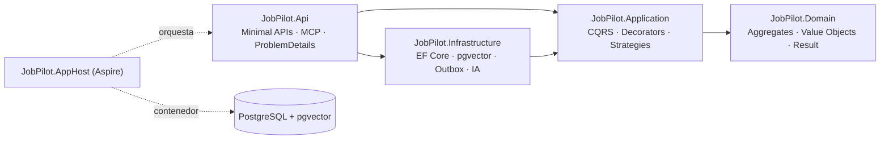
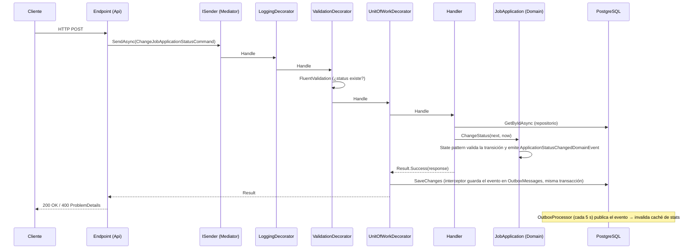

# Arquitectura de JobPilot

## Clean Architecture en 4 capas

**Regla de dependencias:** las flechas apuntan hacia adentro. El dominio no sabe que existe una base de datos,
una API HTTP o un LLM. Esto se verifica con `tests/JobPilot.ArchitectureTests/LayerTests.cs`.

| Capa | Responsabilidad | Ejemplos |
|---|---|---|
| Domain | Reglas de negocio puras | `JobApplication.ChangeStatus`, `ApplicationStatus`, `SalaryRange` |
| Application | Orquestar casos de uso; definir *puertos* (interfaces) | `ChangeJobApplicationStatusCommandHandler`, `IEmbeddingService` |
| Infrastructure | Implementar los puertos con tecnología concreta (*adaptadores*) | `JobPilotDbContext`, `EfRepository<,>`, `LlmJobPostingAnalyzer` |
| Api | Entrada HTTP/MCP y composición (composition root) | `JobApplicationEndpoints`, `Program.cs` |

### ¿Y el "proyecto IoC" o la "capa Repository"?
- **IoC/CrossCutting separado:** innecesario. Cada capa expone `AddApplication()` / `AddInfrastructure()` y
  `Program.cs` las compone. Es más simple y cada capa es dueña de sus registros.
- **Repository como capa:** el repositorio es un *patrón*, no una capa. La interfaz (`IRepository<,>`) vive en
  Domain y la implementación en Infrastructure. Un proyecto "Repository" aparte es herencia del N-tier clásico (DAL).

## Recorrido de una request

`POST /api/v1/applications/{id}/status` con `{ "status": "Interviewing" }`:

## Flujo de la IA

1. **Crear postulación** → evento `JobApplicationCreatedDomainEvent` → Outbox → `GenerateJobApplicationEmbeddingHandler`
   calcula el embedding con `IEmbeddingGenerator` y lo guarda en una columna `vector` (pgvector).
2. **Analizar oferta** (`POST /{id}/analyze`) → `IChatClient.GetResponseAsync<AnalysisPayload>()` fuerza al LLM
   a responder con un JSON Schema (structured output) → se guarda en `jsonb`.
3. **Match** (`GET /{id}/match?resumeId=&strategy=`) → Strategy pattern: keyword, embedding (coseno con SIMD) o hybrid.
4. **Búsqueda semántica** (`GET /search?q=`) → embedding de la consulta + operador `<=>` de pgvector.
5. **MCP** (`/mcp`) → los mismos casos de uso expuestos como tools para agentes (Claude Code, Claude Desktop).

Si no hay proveedor configurado, el patrón **Null Object** (`DisabledAiServices`) hace que los endpoints de IA
respondan `503` con un mensaje claro, y todo lo demás sigue funcionando.

## Observabilidad
`JobPilot.ServiceDefaults` configura OpenTelemetry: trazas de ASP.NET Core, HttpClient, **Npgsql (SQL)** y
**Microsoft.Extensions.AI (llamadas al LLM, tokens)**, más métricas y logs. Con Aspire se ven en el dashboard.
